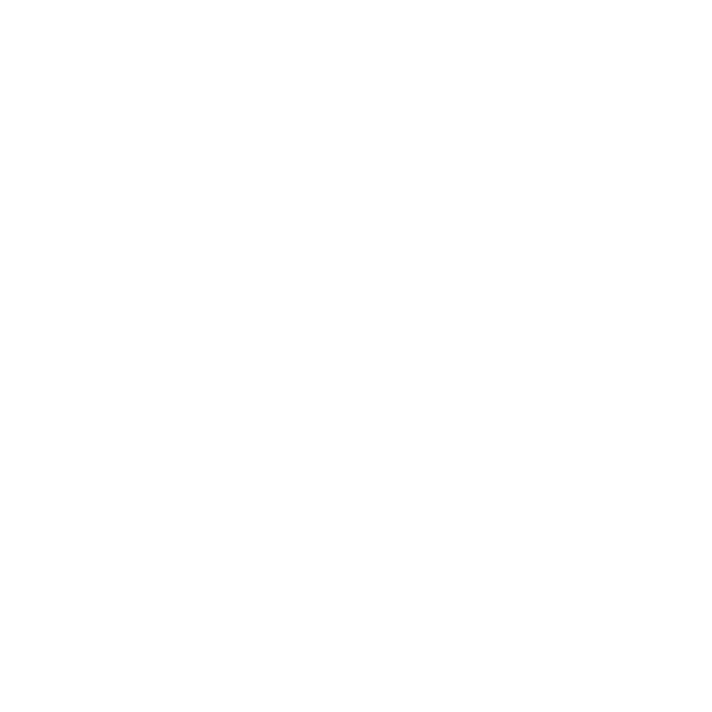
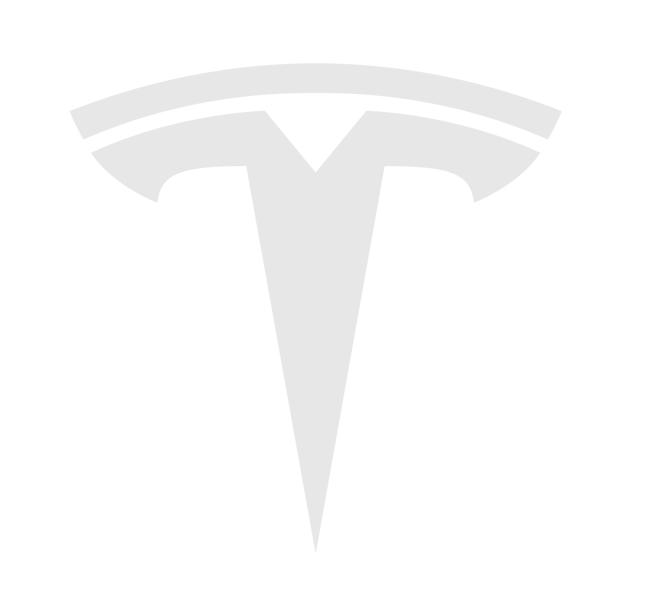

  

<h1 align="center">Johnny Stouffer</h1>

<h3 align="center">Hello!</h3> 

I'm a <b>Software Engineer I</b> at <b>Collins Aerospace</b> that works on mainly <b>Embedded Systems in C++</b>.

On the side I occasionally like to make weekend projects, which are usually <b>Full Stack Development</b> using <b>React</b> and various backend frameworks <b>(Spring Boot, Flask, Django, etc.)</b>

<h2 align="center">Experience</h2>

<table>
  <tr>
    <td width="70" align="center" valign="middle">
      
    </td>
    <td align="left" valign="middle">
      <b>Software Engineer</b> - Collins Aerospace 
      Working on real-time mission system technology
    </td>
    <td align="right" valign="middle" width="140">
      July 26 - Present
    </td>
  </tr>
  <tr>
    <td width="70" align="center" valign="middle">
      
    </td>
    <td align="left" valign="middle">
      <b>Software Engineering Intern</b> - Collins Aerospace 
      Built real-time GPS filtering + predictive mapping
    </td>
    <td align="right" valign="middle" width="140">
      Summer 2025
    </td>
  </tr>
  <tr>
    <td width="70" align="center" valign="middle">
      
    </td>
    <td align="left" valign="middle">
      <b>Software Intern</b> - Tesla 
      Automated KPI dashboards + data pipelines
    </td>
    <td align="right" valign="middle" width="140">
      Summer 2024
    </td>
  </tr>
  <tr>
    <td width="70" align="center" valign="middle">
      
    </td>
    <td align="left" valign="middle">
      <b>DSA Teaching Assistant</b> - Michigan State University 
      Supported 300+ students in DSA
    </td>
    <td align="right" valign="middle" width="140">
      Jan 2025 - May 2026
    </td>
  </tr>
</table>

<h2 align="center">Projects</h2>

<table>
  <tr>
    <td width="50%" align="left" valign="top">
      
      &nbsp;<a href="https://odysseymaps.com"><b>Odyssey Maps</b></a> 
      &nbsp;<code>React</code> <code>Spring Boot</code> <code>PostgreSQL</code>
        
      Track Mario Odyssey progress across 15 kingdoms.
    </td>
    <td width="50%" align="left" valign="top">
      
      &nbsp;<a href="https://focus-youtube.vercel.app/"><b>FocusTube</b></a> 
      &nbsp;<code>Next.js</code> <code>Tailwind</code> <code>YouTube API</code>
        
      Distraction-free YouTube wrapper.
    </td>
  </tr>
</table>

<h2 align="center">Languages and Tools</h2>

  <!-- Languages -->
  
  
  
  
  
  
  

  <!-- Frameworks -->
  
  
  
  
  
  
  

  <!-- Tools -->
  
  
  
  
  

  <!-- AI Tools -->
  
  

<h2 align="center"> Reach Out! </h2>

  
  

  

